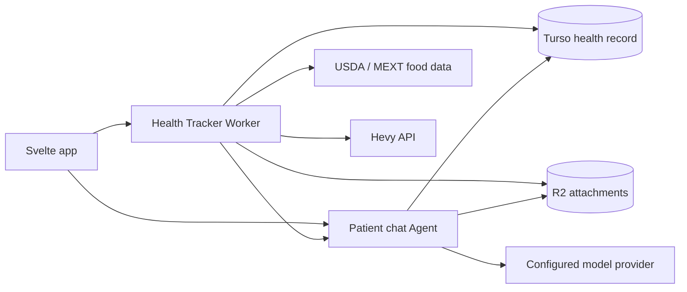

> **Status note (2026-10-16).** This specification was written on 2026-08-15 against an earlier version of the app and has not been revised. The routes and navigation below do not match the app on `main`:
>
> - Navigation on `main` is one dashboard at `/[[tab=dashboardTab]]` with the tabs Lab results (`/`), Body (`/body`), Vitals (`/vitals`), Medicine (`/medicine`), Activity (`/activity`) and Calories (`/calories`). The selected profile is the `?patientId=` query, not a path segment.
> - There are no `/patients/[patientId]/today`, `/records`, `/medicine`, `/calories` or `/assistant` routes, no patient-scoped layout, and no Today or Assistant destination. Under `/patients/[patientId]/` only `extract` and `reports/[reportId]/review` exist.
> - The compatibility redirects proposed for old links do not apply; the dashboard tab routes were built instead.
> - Parts already built in another shape: dose plans (courses, regimens, occurrences) and the Medicine tab, a Calories tab, Hevy import, and MCP medicine tools. No separate Agent Worker exists.
> - The mockup images that `visual-direction.md` describes are kept outside the repository because of their size.

# Health input systems

This specification defines three connected areas for Health Tracker:

- Medicine covers medication details, effective-dated plans, dose records, future occurrences, history, and optional reminders.
- Calories covers meals, dish-photo review, nutrient provenance, exercise imports, history, and user-entered targets.
- Assistant turns text or photos into typed drafts. A person reviews each draft before it changes the health record.

The existing laboratory, body, and vital data keep their current `report` and `record` model. Medicine and nutrition receive separate domain tables because their schedules, events, meals, items, and provenance have different rules.

## Navigation

Six flat dashboard tabs would crowd the current phone navigation. The primary destinations become:

| Destination | Purpose |
| --- | --- |
| Today | A short cross-domain agenda: due medication, recent meals, and recent measurements |
| Records | Existing All metrics, Lab, Body, and Vitals views as secondary tabs |
| Medicine | Today, Plans, History, and Future |
| Calories | Today, History, Exercise, Plans, and Imports |
| Assistant | Full conversation history, pending drafts, and capture controls |

Desktop uses a left rail. Phones use a fixed five-item bottom bar. Medicine and Calories also expose a contextual composer: a right rail on wide screens and a bottom sheet on smaller screens. The full Assistant destination keeps longer conversations and pending drafts accessible.

The destinations use patient-scoped routes:

- `/patients/[patientId]/today`
- `/patients/[patientId]/records?domain=all|lab|body|vital`
- `/patients/[patientId]/medicine?view=today|plans|history|future`
- `/patients/[patientId]/calories?view=today|history|exercise|plans|imports`
- `/patients/[patientId]/assistant`

A shared server layout verifies patient ownership and loads profile-level navigation data. Child routes load only their domain. Existing root links continue through a compatibility redirect during the transition. Date, domain, and subview remain in the URL so browser history and shared links reopen the same screen.

## System boundary

The SvelteKit Worker remains responsible for session authentication, page actions, record confirmation, exports, and account deletion. A separate Cloudflare Agent Worker owns conversation persistence, streaming, and durable photo workflows. A service binding carries internal workflow and deletion requests from the app. Both Workers call the same domain validation and read-model modules. Turso remains the canonical health record. Agent SQLite stores conversation state only.

## Product rules

| Area | Rule |
| --- | --- |
| Confirmation | Text interpretation and photo analysis create a server-side pending action. Confirmation identifies that stored action by ID and version. |
| Medication history | A correction points to the earlier dose event. The read model resolves the chain while the original record remains available for audit and export. |
| Unrecorded occurrences | A past medication occurrence with no event is shown as “No record.” “Skipped,” “missed,” and “uncertain” appear only after the person records that fact. |
| Nutrition estimates | A dish photo can produce a range, a source match, and a short question. Confirmed values retain the evidence used to derive them. |
| Exercise | A Hevy workout supplies workout structure. Calories burned are stored only when a source supplies them or the person enters them. |
| Effective dates | Medication regimens and calorie targets preserve prior versions. Changes do not rewrite earlier days. |
| Idempotency | Interactive writes, imports, workflow steps, and external syncs use idempotency keys. |
| Ownership | Domain services check patient ownership before reading attachments, drafts, plans, events, meals, workouts, or conversations. |
| Logging | Operational logs contain correlation IDs, event classes, durations, and error codes. They exclude health content. |
| Locales | English, Japanese, and Simplified Chinese ship together. Dates, times, units, and food-source labels use the selected locale. |

## Shared concepts

### Pending action

A pending action is a typed, expiring draft stored on the server. Its payload has a schema version, hash, patient owner, source turn, attachment links, and status. Editors update the stored draft through a typed endpoint. Confirmation sends the action ID, expected version, and idempotency key. The server reloads and validates the stored payload before calling a domain command.

Statuses are `processing`, `pending`, `failed`, `confirmed`, `discarded`, `expired`, and `superseded`. A failed action retains its editable input and a retryable error class. A confirmed action records the resulting entity IDs. Repeating the same confirmation returns the original result.

### Attachment

Meal photos and medication-label photos share a patient-scoped attachment service. The browser transcodes photos before upload, removes metadata, enforces dimension and byte limits, and creates a thumbnail. R2 stores transformed images under opaque keys. Turso stores ownership, media type, dimensions, digest, retention state, and references to records or drafts.

### Provenance

Every committed record has a source such as `manual`, `assistant`, `photo`, `mcp`, `import`, or `integration`. Imported entities also retain provider IDs and revisions. Estimated nutrition items retain provider snapshots, estimate ranges, and the fields changed during review.

## Delivery shape

The first usable release includes navigation, manual medication capture, manual meal capture, history, future medication occurrences, exports, and the pending-action boundary. Photo capture and chat follow once those domain commands are stable. Hevy, food-data lookup, MCP extensions, reminders, and broader import adapters arrive as separate changes.

Detailed specifications:

- [Medicine](./medicine.md)
- [Calories](./calories.md)
- [Assistant](./assistant.md)
- [Visual direction](./visual-direction.md)
- [Delivery plan](./delivery.md)

## Release gates

- All new domain functions have cross-patient authorization tests.
- Schedule tests cover daylight-saving transitions, repeated local times, skipped local times, plan overlap, future changes, pauses, and corrections.
- Meal tests cover nullable nutrients, estimate ranges, provenance snapshots, draft expiry, and confirmation replay.
- Import and sync tests cover pagination, retries, deletions, cursor recovery, and source-key collisions.
- Browser tests cover phone and desktop layouts, keyboard use, screen-reader labels, reduced motion, light mode, and dark mode.
- The versioned export round-trips through a scratch database before any production schema change.
- Generated schema statements are reviewed against a backup. Production database changes require a separate release decision.
