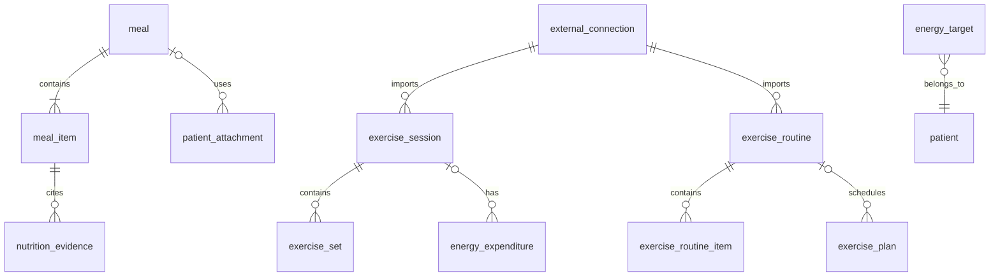
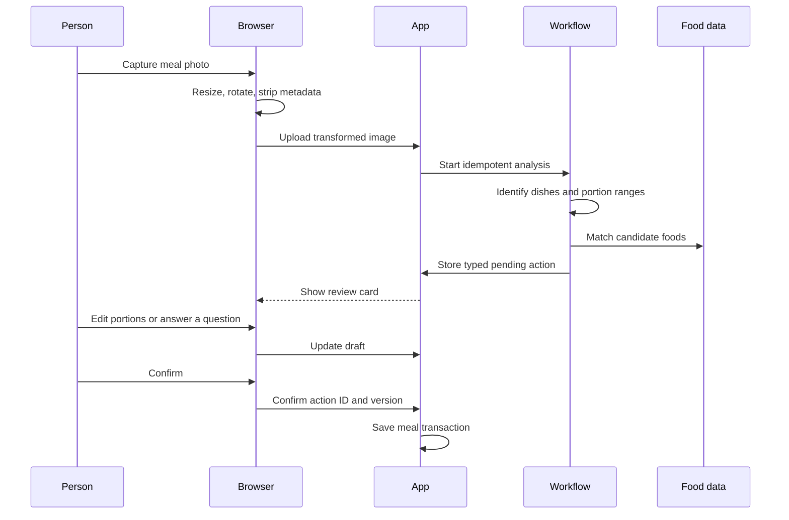

> **Status note (2026-10-16).** This specification was written on 2026-08-15 against an earlier version of the app and has not been revised. The routes and navigation below do not match the app on `main`:
>
> - Navigation on `main` is one dashboard at `/[[tab=dashboardTab]]` with the tabs Lab results (`/`), Body (`/body`), Vitals (`/vitals`), Medicine (`/medicine`), Activity (`/activity`) and Calories (`/calories`). The selected profile is the `?patientId=` query, not a path segment.
> - There are no `/patients/[patientId]/today`, `/records`, `/medicine`, `/calories` or `/assistant` routes, no patient-scoped layout, and no Today or Assistant destination. Under `/patients/[patientId]/` only `extract` and `reports/[reportId]/review` exist.
> - The compatibility redirects proposed for old links do not apply; the dashboard tab routes were built instead.
> - Parts already built in another shape: dose plans (courses, regimens, occurrences) and the Medicine tab, a Calories tab, Hevy import, and MCP medicine tools. No separate Agent Worker exists.
> - Mockup images referenced from `visual-direction.md` (`assets/medicine-desktop-light.png`, `assets/calories-mobile-dark.png`) are not in the repository because of their size.

# Calories

The Calories area centers on fast meal capture, visible uncertainty, and useful history. It also stores workouts and optional energy targets. Food intake, workouts, and energy expenditure remain separate concepts throughout the data model and interface.

## Views

### Today

The day view contains:

- energy logged from confirmed meals;
- an optional target range set by the person;
- protein, carbohydrate, and fat totals when available;
- meal sections with photos, items, portions, and estimate labels;
- a separate exercise section;
- a prominent photo button, text composer, and manual entry action.

The header says “logged” and uses neutral colors. It does not label a day as successful or failed. A target bar appears only when a plan covers the selected day.

Display preferences can hide targets, macro totals, energy totals, or trend charts while retaining the meal record and photo capture. These settings affect presentation and leave exports unchanged.

### History

History shows day rows with intake totals, nutrient coverage, meal count, exercise count, and source markers. Selecting a day opens its meals and workouts. Trend charts show recorded values and data gaps. Estimates remain distinguishable from label, database, device, import, and user-entered values.

### Exercise

Exercise lists imported and manual sessions with provider, start time, duration, exercises, sets, and source revision. Energy expenditure is shown only when an attached source supplies a value or the person enters one.

### Plans

Plans contains optional effective-dated energy targets and, in a later release, scheduled workout routines. An energy plan can contain an energy range and optional macro ranges. The person supplies the targets and note. The first release does not calculate a target from body measurements, age, or sex fields.

### Imports

Imports support the app’s own versioned export first. A column-mapping wizard handles older food logs after the user supplies a real file. Provider presets ship only with fixtures that confirm their headers, units, date semantics, and duplicate keys.

## Data model

### `meal`

- `id`, `patientId`
- `eatenAt`, local date snapshot, timezone snapshot
- optional meal type and title
- source: `manual`, `assistant`, `photo`, `mcp`, `import`
- optional attachment ID
- optional import source key
- idempotency key, notes, `createdAt`, `updatedAt`

Committed meals contain confirmed items. Drafts live in the shared pending-action table.

### `meal_item`

- `id`, `patientId`, `mealId`, display order
- item name and optional brand
- portion value, unit, and plain-language portion label
- energy low, high, and selected values
- protein, carbohydrate, fat, fiber, and sodium values when available
- per-field basis: `label`, `database`, `model_estimate`, `user`, or `import`
- flags recording which fields the person adjusted during review

Nullable nutrients remain null. The system does not replace an unknown with zero. A selected estimate stays inside its displayed range until the person explicitly enters a value outside it; that edit expands the range and records user input as the basis.

### `nutrition_evidence`

Evidence preserves the material used for an item estimate:

- provider such as `usda_fdc`, `mext`, `package_label`, `vision`, `user`, or an import source;
- provider item ID and dataset release;
- matched name and serving basis;
- nutrient snapshot;
- estimate range and uncertainty reason;
- retrieval time and model-run identifier when applicable.

The saved snapshot protects history from later provider changes. Re-analysis creates new evidence and requires another review before it changes a confirmed meal.

### `exercise_session`

- `id`, `patientId`
- provider, provider workout ID, provider revision
- start and end instants, local date snapshot, timezone
- title, notes, normalized activity type
- raw provider snapshot, import time, optional deleted-at time
- idempotency key

### `exercise_set`

Set rows preserve order, exercise template ID, title, set type, weight, repetitions, duration, distance, and provider-specific details. Unknown values remain null.

### `exercise_routine` and `exercise_plan`

Routine rows snapshot a provider routine, folder, exercise order, set targets, revision hash, and sync time. An optional app plan references a routine snapshot and stores effective dates, selected weekdays, timezone, and note. Provider routines remain usable without an app schedule.

### `energy_expenditure`

This table attaches an energy value to a time range or workout:

- `kcal`, interval, optional exercise session;
- method: `device`, `provider`, `manual`, or a future opt-in estimate;
- source ID, source timestamp, and optional uncertainty range.

A workout can exist without an expenditure row. This is the expected state for a Hevy workout when no separate source reports energy.

### `energy_target`

Targets are immutable effective-dated rows with optional energy and macro ranges, timezone, note, source, and supersedes link. Overlapping target intervals for the same patient are rejected.

### `external_connection`

Provider connections contain an encrypted credential blob, key version, provider account metadata, status, last sync time, next cursor, error class, and revocation time. A Worker secret protects the envelope key. Credentials never return to the browser after creation and never enter logs.

## Photo capture

### Capture rules

1. The browser applies orientation, downsizes the image, removes metadata, and creates a thumbnail before upload.
2. The server validates media type, decoded dimensions, byte size, patient ownership, and digest.
3. A durable workflow runs image interpretation and food-data matching under one idempotency key.
4. The result contains dish candidates, portion ranges, nutrient ranges, evidence, and explicit unknowns.
5. The system asks at most two short questions when container size, portion count, ingredients, or cooking method materially changes the estimate.
6. The server stores a typed pending action. The photo flow does not create a meal at this stage.
7. The review card lets the person rename dishes, change portions, select a database match, add missing items, and remove incorrect items.
8. Confirmation writes the meal, items, evidence snapshots, attachment link, and action result in one transaction.

An analysis failure keeps the transformed photo and any typed meal text in a failed draft. Retry reuses the attachment digest and analysis ID. Manual item entry remains available from the same card.

The stored image is the transformed copy. A profile setting controls whether confirmed-meal images remain attached. Deleting the meal or selecting “Remove photo” schedules the R2 objects for deletion and keeps the nutrient record.

### Review presentation

The review card shows:

- one row per dish;
- a portion range or editable portion;
- an energy range such as `620–760 kcal`;
- a plain uncertainty reason such as “portion size needs review”;
- source matches and release labels;
- a total range and selected value;
- “Save meal,” “Adjust portions,” and “Discard” actions.

Photo-based portion estimation has documented error, including systematic error at higher intake levels. A photo therefore starts a review flow and retains a range. See [image-based dietary assessment research](https://pmc.ncbi.nlm.nih.gov/articles/PMC9291996/) and the [Nutris-Phone validation study](https://pmc.ncbi.nlm.nih.gov/articles/PMC10260410/).

## Food data

### USDA FoodData Central

The USDA adapter supports food search and food details. It stores the FDC ID, description, serving basis, nutrient snapshot, and retrieval date. FoodData Central data are public domain under CC0. API use requires a data.gov key. See the [FoodData Central API guide](https://fdc.nal.usda.gov/api-guide/).

### Japanese food composition data

The Japanese adapter builds a versioned search index from the Ministry of Education, Culture, Sports, Science and Technology’s published food composition tables under their stated usage terms. It records the table release with each match and uses the official search database for validation. Japanese dish names remain in their original language. See the [food composition database](https://fooddb.mext.go.jp/search.html), its [usage and CSV guidance](https://fooddb.mext.go.jp/help.html), the [Standard Tables of Food Composition in Japan](https://www.mext.go.jp/a_menu/syokuhinseibun/index.htm), the [2020 eighth revised edition](https://www.mext.go.jp/a_menu/syokuhinseibun/mext_01110.html), and the [database revision history](https://fooddb.mext.go.jp/history.pl).

### Matching policy

The interpreter may propose provider matches. It does not silently replace the dish name or serving. The review card distinguishes a generic match from a package label. Confirmed items retain the provider snapshot and user-adjusted portion.

## Text and manual capture

Text such as “small bowl of rice, grilled salmon, miso soup” follows the same pending-action shape as a photo. The Assistant proposes items and asks for one material clarification when needed. Manual entry supports a meal title, item rows, portion labels, energy range, selected value, optional macros, and source.

“Use again” starts a new pending action from a prior confirmed item. The copied values retain their original evidence, and the person reviews the new portion and time.

## Hevy integration

Hevy’s public API uses an API key and is limited to Hevy Pro accounts. The integration page explains this before requesting a key. The key is encrypted immediately and replaced in the UI by connection status and a revoke action.

Initial synchronization:

1. Validate the key with a small authenticated request.
2. Page through existing workouts.
3. Upsert sessions by provider workout ID.
4. Save exercises and sets in provider order.
5. Store a sync checkpoint.

Incremental synchronization uses Hevy’s workout-events endpoint so updates and deletions can be applied. Every page and event uses a provider revision key. A failed page leaves the prior cursor unchanged. Rate-limit responses use bounded retry with jitter.

A separate read-only sync imports Hevy routines, routine folders, and exercise templates. Health Tracker can then show a routine as a workout plan without changing the Hevy account. Creating or updating Hevy routines from Health Tracker remains a later, approval-gated capability because the provider API is marked as early and subject to change.

The official workout schema exposes workout timing, exercises, sets, weight, repetitions, distance, and duration. It does not expose a calorie field. The app therefore leaves expenditure empty for Hevy-only sessions. See the [Hevy API documentation](https://api.hevyapp.com/docs/).

Apple Health or another future device adapter can attach measured active-energy records through `energy_expenditure`. Matching uses time overlap and provider identifiers. A manual value remains clearly labeled as manual.

## Older app exports

The import framework is a registry of pure parsers. Each parser returns normalized candidates, warnings, skipped rows, source keys, and a preview. The browser parses local files and sends normalized rows after review.

The sequence is:

1. Versioned Health Tracker export with full round-trip tests.
2. Generic CSV mapping with saved local mapping profiles.
3. Provider presets backed by anonymized fixtures supplied by the user.

The wizard requires explicit mappings for date, timezone, item name, energy unit, and decimal format. It reports skipped rows. Replace-by-source is a separate action with its own preview.

## Plans and summaries

Daily summaries contain:

- confirmed intake totals and range totals;
- nutrient totals with coverage indicators;
- recorded exercise sessions;
- recorded expenditure totals by method;
- optional target range and delta.

When both sides exist, the interface may show `confirmed intake − recorded activity energy` under the label “Intake minus recorded activity.” It does not call this a daily surplus, deficit, or total energy balance because basal expenditure is absent.

The initial overview does not compute basal metabolic rate or total daily energy expenditure. A later calculator can be offered as an opt-in feature with visible assumptions, effective dates, and an estimate range.

## Assistant contracts

Initial Calories intents are:

- `nutrition.meal.propose`
- `nutrition.meal.photo.propose`
- `nutrition.meal.copy.propose`
- `nutrition.meal.correct.propose`
- `exercise.manual.propose`
- `exercise.plan.propose`
- `nutrition.target.propose`

The model receives the selected day, locale, recent confirmed foods, current target, and limited source matches. A meal proposal contains item ranges and evidence references. Its tool creates a pending action. The person edits and confirms through the same components used by photo and manual capture.

Examples:

- “Lunch was the same curry as yesterday, half the rice” creates a copied meal draft with the portion change visible.
- “This photo has two servings” updates the stored pending action and recalculates its range.
- “Imported today’s workout from Hevy” reports the sync result and does not invent an expenditure value.

## MCP surface

Read tools:

- `get_meals`
- `get_nutrition_summary`
- `get_exercise_sessions`
- `get_exercise_plans`
- `get_energy_targets`

Capture tools:

- `propose_meal`
- `propose_meal_correction`
- `propose_energy_target`
- `propose_exercise_plan`

Scopes are `nutrition:read` and `nutrition:propose`. Exercise reads can use a separate `exercise:read` scope if provider details require independent consent. File upload, photo capture, and provider-secret management stay inside the authenticated app.

## Acceptance cases

- A multi-dish photo produces editable items, explicit unknowns, estimate ranges, and source candidates.
- A photo creates no meal before confirmation.
- A draft edit changes the server-side action version and invalidates an older confirmation request.
- Repeating confirmation returns the original meal IDs.
- A user-entered value remains identifiable after later re-analysis.
- A provider dataset update leaves historical meal snapshots unchanged.
- A meal can contain energy with unknown macros.
- A missing nutrient stays null and does not lower a total as if it were zero.
- A target applies only inside its effective interval.
- A day without a target presents logged intake without a target judgment.
- A Hevy sync imports workouts, updates changed workouts, applies deletions, and resumes from the last committed cursor.
- A routine sync preserves provider folders, order, set targets, and revision snapshots.
- An app workout plan keeps its effective dates after a provider routine changes.
- A Hevy-only workout has no calorie-burn value.
- Importing the same file twice creates no duplicate meals or workouts.
- A cross-patient attachment, draft, meal, target, connection, or workout ID returns no data.
- Export followed by import preserves meal items, evidence snapshots, estimate ranges, workouts, expenditure sources, targets, and attachment metadata.
