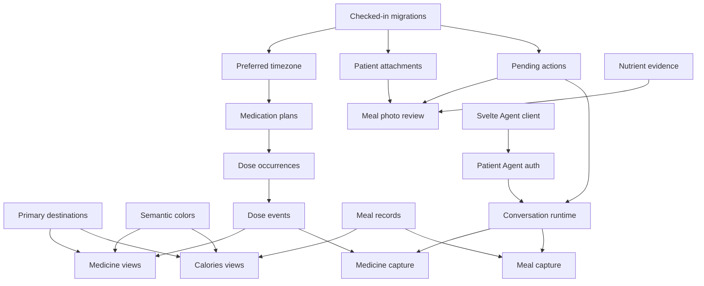

> **Status (2026-10-16).** Written on 2026-08-15 against an earlier version of the app. Routes and navigation differ from `main`; see the [status note](./README.md).

# Delivery plan

The two domains can ship incrementally. Each pull request introduces one capability, leaves existing metric flows working, and includes its own tests. Medicine and Calories remain behind patient-level feature flags until their core read and write paths pass the release gates.

## Dependency map

## Pull request backlog

### Foundation

| # | Proposed title | Scope | Exit condition |
| --- | --- | --- | --- |
| 1 | `chore(database): adopt checked-in migrations` | Add generated SQL migrations, a scratch-database command, a schema review command, and a documented backup gate | A new database and a copied database reach the same schema in CI |
| 2 | `refactor(navigation): establish primary destinations` | Add a patient-scoped layout with Today, Records, Medicine, Calories, and Assistant routes; move existing domain tabs under Records | Desktop and phone navigation preserve patient ownership, deep links, and root compatibility |
| 3 | `feat(theme): introduce semantic colors` | Replace shared shell colors with light/dark semantic tokens | Existing pages pass contrast checks in both themes |
| 4 | `feat(profile): store preferred timezone` | Add the profile timezone field, explicit browser suggestion, and shared date utilities | Day grouping is stable across runtime timezones |
| 5 | `feat(media): store patient attachments` | Add opaque attachment records, transformed image upload, protected reads, retention, and deletion | Cross-patient reads fail; metadata is stripped; retry deduplicates by digest |
| 6 | `feat(capture): persist pending actions` | Add the typed draft table, versioned edits, expiry, discard, confirmation replay, and result references | Stale or replayed confirmations cannot create a second record |

### Medicine

| # | Proposed title | Scope | Exit condition |
| --- | --- | --- | --- |
| 7 | `feat(medicine): create medication catalog` | Add medication identities, descriptive revisions, ownership checks, archive behavior, forms, routes, units, and validation | Multiple medicine forms can be created, revised, viewed, archived, and deleted with a profile |
| 8 | `feat(medicine): version medication plans` | Add immutable plan versions, schedule rules, pause, resume, stop, taper, overlap checks, and preview | Every plan edit creates a traceable effective interval |
| 9 | `feat(medicine): project dose occurrences` | Add schedule projection, 42-day materialization, deterministic keys, timezone handling, and reconciliation | DST, interval, weekday, cycle, taper, pause, and PRN fixtures pass |
| 10 | `feat(medicine): append dose events` | Add taken, skipped, uncertain, correction, note, off-schedule, and idempotent write paths | “No record” remains derived; correction chains resolve consistently |
| 11 | `feat(medicine): render today schedule` | Add the Medicine Today view, day selector, state controls, summary counts, and phone layout | A dose can be recorded in one tap and corrected from the same view |
| 12 | `feat(medicine): render plan history` | Add active, paused, future, and ended plan cards with the version timeline | A future taper and a pause are understandable before activation |
| 13 | `feat(medicine): render dose history` | Add event filters, correction display, source labels, and future projection | Every state matches the shared read model |
| 14 | `feat(export): include medicine records` | Add medication, revision, plan, rule, occurrence, and event sections to the versioned export | Export-import round trip preserves IDs, timezones, and correction links |

### Calories

| # | Proposed title | Scope | Exit condition |
| --- | --- | --- | --- |
| 15 | `feat(nutrition): store meals` | Add meals, items, manual editor, idempotent writes, delete, and correction metadata | A meal with partial nutrients saves without invented zeros |
| 16 | `feat(nutrition): retain nutrient evidence` | Add ranges, per-field basis, evidence snapshots, source versions, and user-adjusted flags | Historical values remain stable after source refresh |
| 17 | `feat(nutrition): render calorie day` | Add daily totals, meal sections, item details, quick reuse, and neutral empty states | Totals reconcile with confirmed item values and null coverage |
| 18 | `feat(nutrition): set energy targets` | Add effective-dated energy and macro ranges with overlap validation | A target appears only on covered dates |
| 19 | `feat(nutrition): render meal history` | Add day rows, filters, trend ranges, and source labels | Estimated, database, label, import, and user values remain distinguishable |
| 20 | `feat(export): include nutrition records` | Add meals, items, evidence, targets, and attachment metadata | Export-import round trip preserves ranges and provenance |

### Photo capture

| # | Proposed title | Scope | Exit condition |
| --- | --- | --- | --- |
| 21 | `feat(nutrition): review meal photos` | Add workflow-backed interpretation, processing card, portion ranges, typed draft editor, and photo retention | A photo creates no meal until the person confirms |
| 22 | `feat(nutrition): search USDA foods` | Add FoodData Central search, detail snapshots, caching, source labels, and rate handling | Confirmed matches retain the FDC ID and dataset snapshot |
| 23 | `feat(nutrition): search Japanese foods` | Add a versioned MEXT index, release snapshots, Japanese labels, usage attribution, and matching review | Japanese foods retain original names and source release |

### Exercise integration

| # | Proposed title | Scope | Exit condition |
| --- | --- | --- | --- |
| 24 | `feat(hevy): protect API connections` | Add encrypted per-patient credentials, validation, status, key rotation metadata, and revocation | The API key cannot be read back or appear in logs |
| 25 | `feat(hevy): sync workouts` | Add initial pagination, workout-event cursors, normalized sessions, sets, revisions, deletions, and retry | Re-running a sync creates no duplicates and preserves the cursor after failure |
| 26 | `feat(exercise): render workout history` | Add workout day rows, session details, set lists, provider source, and empty expenditure state | Hevy-only workouts display no calorie value |

### Assistant

| # | Proposed title | Scope | Exit condition |
| --- | --- | --- | --- |
| 27 | `spike(assistant): validate Svelte Agent client` | Exercise the public Agent chat protocol through `AgentClient` in a minimal Svelte page | Send, stream, reconnect, cancel, clear, tool parts, and cross-tab sync pass |
| 28 | `feat(assistant): record model consent` | Add first-use disclosure, provider policy version, withdrawal, and manual fallback | No health context reaches a model before consent |
| 29 | `feat(assistant): authenticate patient agents` | Add one-time grants, HMAC instance names, origin checks, reconnect refresh, and revocation | URLs expose no health identifiers; a forged or expired grant fails |
| 30 | `feat(assistant): persist patient conversations` | Add `AIChatAgent`, recovery, retention, clear, export, deletion, and the Svelte store | Conversation state survives reconnect and obeys profile deletion |
| 31 | `feat(assistant): review typed drafts` | Add proposal tools, review cards, typed draft edits, confirmation routing, and stale-card handling | No model payload reaches a domain writer directly |
| 32 | `feat(assistant): capture medication events` | Add medicine read context, dose proposals, correction proposals, and ambiguity handling | Medicine chat fixtures produce the same results as manual capture |
| 33 | `feat(assistant): capture meals` | Add meal text proposals, prior-meal reuse, item ranges, and corrections | Nutrition chat fixtures produce the same confirmed shape as manual capture |
| 34 | `feat(assistant): process meal photos` | Connect conversation attachments to the meal-photo workflow and processing cards | Chat photo and Calories photo use the same pending-action schema |

### MCP

| # | Proposed title | Scope | Exit condition |
| --- | --- | --- | --- |
| 35 | `feat(mcp): expose medicine reads` | Add fine-grained scope, consent copy, medicine read tools, caps, and instructions | Existing OAuth grants see no medicine data without reauthorization |
| 36 | `feat(mcp): propose medicine captures` | Add dose, correction, and plan proposal tools returning approval links | External retries create one pending action |
| 37 | `feat(mcp): expose nutrition reads` | Add nutrition scope, meal summaries, exercise reads, target reads, caps, and instructions | Results preserve ranges, nulls, methods, and sources |
| 38 | `feat(mcp): propose nutrition captures` | Add meal, correction, and target proposal tools returning approval links | A proposal cannot confirm itself |

### Later capabilities

| # | Proposed title | Scope | Exit condition |
| --- | --- | --- | --- |
| 39 | `feat(reminders): schedule dose notifications` | Add preferences, Agent schedules, cancellation, quiet-hour behavior, and privacy text | Plan changes reconcile every pending reminder |
| 40 | `feat(reminders): deliver dose notifications` | Add channel delivery, idempotency, retries, audit state, and lock-screen privacy | At-least-once execution produces one visible notification |
| 41 | `feat(import): map nutrition CSV files` | Add column mapping, previews, saved mappings, warnings, and source replacement | A real anonymized fixture round-trips without duplicate rows |
| 42 | `feat(export): include exercise records` | Add sessions, sets, provider revisions, expenditure, and deletion metadata | Export-import round trip preserves workout structure and energy sources |
| 43 | `feat(hevy): import workout routines` | Add routine folders, templates, routine snapshots, revisions, and read-only sync | Provider order and set targets survive re-sync |
| 44 | `feat(exercise): schedule workout routines` | Add effective dates, weekday selection, timezone, pause, and history | A plan retains its routine snapshot after a provider revision |
| 45 | `feat(today): render health agenda` | Add due medication, recent meals, recent measurements, and pending drafts to the Today route | Each card deep-links to its source domain and follows the same patient timezone |
| 46 | `feat(mcp): propose exercise plans` | Add an exercise-plan proposal scope, typed draft, approval link, and routine snapshot | An external client cannot publish or schedule a routine without app confirmation |
| 47 | `feat(assistant): capture exercise plans` | Add routine context, schedule proposals, typed review, and effective-date handling | Chat planning uses the same exercise-plan command as the manual editor |
| 48 | `feat(nutrition): configure summary visibility` | Add per-profile controls for energy, macro, target, and trend presentation | Hidden summaries stay absent across phone, desktop, and Assistant context |

## Recommended release order

1. Foundation PRs 1–6.
2. Medicine PRs 7–14.
3. Calories PRs 15–20.
4. Agent-client spike 27 while domain work proceeds.
5. Photo PRs 21–23.
6. Assistant PRs 28–34.
7. Hevy PRs 24–26.
8. MCP PRs 35–38.
9. Later capabilities 39–48 after the core release is stable.

Medicine and Calories can be developed in separate worktrees after the foundation lands. The Assistant adapters depend on stable domain commands and pending actions. Hevy can proceed once exercise tables exist in the nutrition schema.

## Database practice

The repository uses Drizzle schema push without checked-in migration files. The first foundation PR introduces reviewable migrations before new health tables reach production.

For each schema change:

1. Generate SQL from the Drizzle schema.
2. Apply it to a new scratch database.
3. Apply it to a copy of representative existing data.
4. Run authorization, export, import, and read-model tests.
5. Review table rebuilds, indexes, foreign keys, nullability, and cascade behavior.
6. Take a production backup.
7. Apply the migration during an explicit release step.
8. Run read-only integrity queries and smoke tests.

Initial migrations are additive. Feature flags keep new reads and writes inactive until their UI is ready. Each table has patient-scoped indexes and database constraints for idempotency keys, external IDs, plan overlap support, and deterministic occurrence keys.

## Branch and worktree policy

- Create each branch from the latest `origin/main` in its own worktree.
- Use project prefixes such as `feat/`, `fix/`, `refactor/`, `chore/`, `test/`, or `spike/`.
- Keep the active working tree untouched when it contains unrelated changes.
- Rebase or merge the latest target branch before final verification.
- Commit generated database artifacts only when their schema change is the PR’s capability.

Each title above names one capability. Before opening a PR, review any title or description that joins capabilities with “and,” “+,” “also,” or “plus.” Split the work unless both parts form one inseparable behavior.

## Test strategy

### Pure domain tests

- Medication schedule projection across timezones, DST gaps, repeated local times, leap days, weekday rules, date intervals, fixed intervals, cycles, tapers, pauses, future versions, and PRN plans.
- Dose-event folding for taken, skipped, missed reason, uncertain, no record, off-schedule, correction chains, and retries.
- Nutrition totals with null nutrients, ranges, selected values, evidence updates, target intervals, and source coverage.
- Hevy normalization for pagination, changes, deletions, unknown set fields, units, and cursor recovery.

### Database tests

- Every read and write attempts a valid owner, another owner, missing patient, archived entity, expired draft, stale draft, and repeated idempotency key.
- Transactions roll back on an invalid child row.
- Profile deletion cascades through domain rows and schedules attachment cleanup.
- Export-import round trips compare semantic records and source metadata.

### Agent tests

- Public protocol contract with Svelte.
- Grant signing, audience, expiry, nonce, reconnect, revocation, and HMAC instance isolation.
- Tool allowlists and patient-context caps.
- Invalid model arguments, unknown medicine names, ambiguous dose statements, negation, corrections, and relative time.
- Prompt injection from message text, OCR text, food-provider text, and tool results.
- Stream interruption, recovery, cancellation, overlapping messages, workflow completion, and deletion mid-turn.

### Browser tests

- Desktop and phone navigation.
- Light and dark themes.
- Keyboard and screen-reader operation.
- 200% zoom, long translations, offline recovery, expired drafts, and provider errors.
- One-tap dose capture, correction, plan preview, manual meal capture, photo review, Hevy connection, chat capture, and MCP approval links.

## Rollout

Feature flags are patient-scoped:

- `navigationV2`
- `medicine`
- `calories`
- `mealPhoto`
- `assistant`
- `hevy`
- `mcpMedicine`
- `mcpNutrition`
- `medicineReminders`

Rollout moves through a seeded test profile, a private account, a small opt-in group, and general availability. Write capabilities follow read-only views. Model-assisted capture follows manual capture. Provider integrations follow export and deletion verification.

Rollback disables the affected flag and leaves additive data in place. A domain writer stores schema version and source so a corrected release can read earlier rows. Destructive rollback requires a reviewed migration and backup.

## Release checklist

Every PR has:

- generated locale files for English, Japanese, and Simplified Chinese;
- passing format, type, unit, integration, and build checks;
- scratch-database migration verification;
- patient-ownership and idempotency tests;
- accessible light/dark screenshots at desktop and phone sizes for UI work;
- a tested loading, empty, error, and retry state;
- no secrets or health content in logs, fixtures, snapshots, screenshots, or analytics;
- export coverage when it adds a persistent record;
- a rollback or feature-disable path.

No remote schema change, deployment, provider connection, or public URL is part of routine local verification.

## Risk register

| Risk | Control |
| --- | --- |
| Empty medication slot is labeled as a missed dose | “No record” is a separate read-model state with fixtures across every surface |
| Regimen change rewrites history | Immutable plan versions, retained occurrence snapshots, append-only dose corrections |
| Meal photo conveys false precision | Ranges, evidence, visible uncertainty reason, typed review before save |
| Model or browser submits an arbitrary write | Server-side pending action, version check, domain validation, authenticated confirmation |
| Agent URL leaks an identity | Random grant claim, HMAC instance name, short expiry, in-memory token |
| Svelte client depends on private chat internals | Public-protocol spike and pinned SDK contract tests |
| Workflow or queue duplicates work | Step idempotency key and unique pending-action key |
| Hevy schema changes | Raw revision snapshot, defensive normalization, cursor checkpoint, provider error state |
| Hevy workout appears to contain burn calories | Separate expenditure table and an explicit empty state |
| Existing mobile navigation becomes crowded | Five primary destinations with Records as a secondary container |
| Dark mode produces hidden low-contrast states | Semantic tokens and contrast checks before domain dark-mode screenshots |
| Profile deletion leaves conversation or photos | Cross-store deletion job with a retryable completion ledger |
