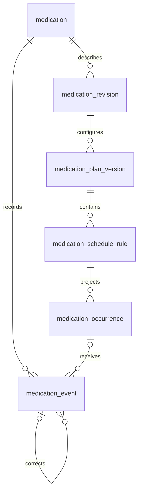

> **Status (2026-10-16).** Written on 2026-08-15 against an earlier version of the app. Routes and navigation differ from `main`; see the [status note](./README.md).

# Medicine

The Medicine area covers today’s due items, the current plan, recorded history, and scheduled changes.

The interface records the person’s account of events. It does not interpret an empty slot as a medical fact or tell the person how to change a dose.

## Views

### Today

The default view is a chronological list of planned occurrences in the patient’s medication timezone. Each row shows local time, medication, expected amount, stored instruction text, and current record state. Primary actions are “Record taken,” “Record skipped,” “Not sure,” and “Change time.”

The header summarizes factual counts for the selected day: taken, due, later, no record, skipped, and uncertain. It avoids an adherence score. A date control supports recent history and a 30-day future preview.

### Plans

Plans groups active, paused, future, and ended medication plans. Each card shows the medication form, strength label, route, schedule in plain language, effective date, next occurrence, and upcoming change. A detail view shows every effective-dated version.

### History

History combines dose events and plan changes in one timeline. Filters cover medication, outcome, source, and date range. Corrections remain visible beside the event they replace.

### Future

Future shows projected occurrences and effective-dated plan changes. It highlights timezone or daylight-saving adjustments before they affect reminders. PRN medications show their stored instructions and latest recorded event because they have no projected due time.

## Record states

| Display state | Meaning |
| --- | --- |
| Upcoming | The planned time is later than the display window |
| Due | The planned time is inside the display window |
| Taken | A confirmed dose event is linked to the occurrence |
| Taken late | A taken event occurred after the planned window; “late” is a timing modifier |
| Skipped | The person explicitly recorded that the dose was not taken |
| Missed | The person selected “missed” as the reason for a skipped event |
| Uncertain | The person explicitly recorded uncertainty |
| No record | The planned time passed without a linked event |
| Cancelled | A later plan version removed this future occurrence |

“No record” stays distinct from “skipped” and “missed” in summaries, exports, chat answers, and MCP results.

## Data model

### `medication`

The stable catalog identity contains:

- `id`, `patientId`
- preferred display name and aliases used for search or chat matching
- `archivedAt`, `createdAt`

### `medication_revision`

An immutable revision records the descriptive fields in effect:

- `id`, `patientId`, `medicationId`
- optional generic and brand names
- `formCode`, optional `formText`
- `routeCode`, optional `routeText`
- structured strength fields when available, plus `strengthLabel` preserving the package wording
- notes, optional label attachment, `effectiveFrom`, optional `effectiveUntil`
- optional `supersedesId`, source, creator, `createdAt`

Form choices include tablet, capsule, liquid, injection, drops, spray, inhaler, patch, topical, suppository, sachet, device, and other. Route and form are separate fields. Free-text fallbacks preserve forms that the initial vocabulary cannot express.

Changing a brand, form, route, strength label, or label attachment creates a revision. Archiving removes a medication from active views. History remains available until the patient profile is deleted.

### `medication_plan_version`

Each row is immutable after creation. It contains:

- `id`, `patientId`, `medicationId`, `medicationRevisionId`
- `state`: `active`, `paused`, or `stopped`
- `effectiveFrom`, optional `effectiveUntil`
- the original local effective date-time and IANA timezone
- optional `supersedesId` and plan-series identifier
- stored instruction text, change reason, source, creator, `createdAt`

A plan change closes the prior effective interval and creates a new version. A pause is a version with no active schedule rules. Resuming creates another active version. A planned taper is a sequence of future active versions. Overlapping effective intervals for the same medication are rejected.

### `medication_schedule_rule`

Separate rules allow different amounts at different times. Each rule carries a schema version, expected dose snapshot, and one of these schedule kinds:

- `local_times`: selected wall-clock times on selected weekdays
- `calendar_interval`: every N local days from an anchor date
- `fixed_interval`: an elapsed duration from an anchor instant
- `cycle`: a stated number of on-days and off-days from an anchor date
- `one_time`: one planned instant
- `as_needed`: no projected occurrences; optional stored limit text is displayed as written

The editor explains the difference between wall-clock schedules and elapsed intervals. A plain-language description is stored beside the validated rule. Computation uses the validated fields.

### `medication_occurrence`

An occurrence is the expected dose slot generated from a schedule rule. It contains:

- `id`, `patientId`, `medicationId`, `planVersionId`, `ruleId`
- deterministic `occurrenceKey`
- `dueAt`, `localDate`, `localTime`, `timezoneSnapshot`, and UTC offset
- display-window boundaries
- expected amount and instruction snapshots
- `state`: `scheduled`, `cancelled`, or `superseded`
- `createdAt`, optional cancellation metadata

The projector maintains a rolling 42-day horizon. A daily reconciliation fills the horizon. Future views may project farther in memory. Plan changes cancel future occurrences from the replaced version and generate new ones. Historical occurrences remain available.

An occurrence key includes the schedule rule and resolved instant, so a retry cannot create a duplicate. A repeated local time during a daylight-saving transition produces one previewed occurrence for a wall-clock rule. A fixed-interval rule preserves elapsed duration. These policies receive unit tests and appear in the plan preview.

### `medication_event`

Dose history is append-only. Each event contains:

- `id`, `patientId`, `medicationId`, optional `occurrenceId`, optional `planVersionId`
- `outcome`: `taken`, `skipped`, `uncertain`, `correction`, or `note`
- `occurredAt` and `recordedAt`
- amount and unit snapshots, optional reason, optional note
- `source`: `manual`, `assistant`, `mcp`, or `import`
- `idempotencyKey`
- optional `correctsEventId`

Off-schedule and PRN doses have no occurrence link. A correction appends a new event that names the earlier event. The read model follows correction chains and rejects loops. There is no routine update or delete path for dose events.

### Reminder records

Reminder delivery is a later capability with two small tables:

- `medication_reminder_preference` stores enabled channels, offsets, quiet-hour behavior, and lock-screen privacy choice.
- `medication_reminder_delivery` stores occurrence, channel, scheduled time, delivery state, attempt count, and idempotency key.

The occurrence remains the source of reminder timing. Taking or cancelling an occurrence cancels pending deliveries. At-least-once delivery paths use a unique delivery key to prevent duplicate notifications.

## Schedule and timezone rules

The patient profile has a preferred calendar timezone. Every medication plan also snapshots its timezone. The plan timezone controls projected wall-clock occurrences; the profile timezone controls day grouping elsewhere in the app.

When the browser timezone changes, the interface offers three explicit choices:

- keep the current plan timezone;
- move future wall-clock times to the new timezone;
- record a future timezone change date.

The app shows a preview before applying any choice. It does not silently reinterpret an active plan.

All instants are stored in UTC. Local input, timezone, and UTC offset are retained for audit. Schedule code uses one shared timezone utility on the server and in tests. Day boundaries never rely on the runtime machine timezone.

## Core flows

### Add a medication

1. Enter the medication name, form, route, strength label, and optional notes.
2. Add one or more schedule rules or mark it as needed.
3. Select the effective date and plan timezone.
4. Review the next seven days, including timezone adjustments.
5. Confirm the medication, descriptive revision, and first plan version in one transaction.

A medication-label photo may prefill a draft. The image parser extracts printed fields and preserves the attachment. The person reviews every field. The feature does not identify an unlabeled pill.

### Record a dose

1. Select a planned occurrence or an off-schedule medication.
2. Choose taken, skipped, or uncertain.
3. Adjust the event time and amount when needed.
4. Confirm.

The common “Record taken now” action uses a client idempotency key and remains available as a one-tap path. Undo creates a correction event.

### Change a plan

1. Open the current plan and choose an effective time.
2. Edit schedule rules, dose snapshots, instructions, or state.
3. Review affected future occurrences.
4. Confirm a new immutable version.

Backdated changes receive an additional warning because they can alter historical “No record” slots. The preview lists affected dates before confirmation.

### Review history

History shows the recorded time and effective time separately when they differ. Each row names its source. Corrected events are visually linked and excluded from current summaries.

## Read models

Pure modules under `src/lib/medicine/` provide:

- current plan state at an instant;
- occurrence projection for a date range;
- occurrence-to-event matching;
- day summaries by factual state;
- next occurrence;
- medication timeline;
- correction-chain resolution.

The UI, Assistant, exports, and MCP tools call these functions. Presentation windows such as “due now” are exported constants with tests. They do not change prescription instructions.

## Assistant contracts

Initial Medicine intents are:

- `medicine.dose.propose`
- `medicine.event.correct.propose`
- `medicine.catalog.propose`
- `medicine.plan.propose`
- `medicine.pause.propose`
- `medicine.resume.propose`
- `medicine.stop.propose`

The model receives active medication names, aliases, today’s occurrences, current timezone, and recent dose states. It can ask one short clarification when a statement matches multiple medications or occurrences. Its tool creates a pending action. The browser renders a typed preview and confirms through the authenticated app.

Examples:

- “I took my afternoon dose 20 minutes ago” produces a dose preview with the matched medication, amount, and resolved time.
- “I might have taken the morning pill” produces an uncertain-event preview.
- “Skip tonight because my doctor changed the plan” asks whether this is one skipped occurrence or a plan change.

The Assistant can repeat stored instructions and summarize records. It does not generate a dose, diagnose an interaction, or provide a universal missed-dose instruction.

## MCP surface

Read tools:

- `list_medications`
- `get_medication_plan`
- `get_medication_schedule`
- `get_medication_history`

Capture tools:

- `propose_dose_event`
- `propose_medication_plan`
- `propose_medication_correction`

Each capture tool creates a pending action and returns a concise preview plus an approval link. Initial scopes are `medicine:read` and `medicine:propose`. Existing grants require explicit reauthorization before these tools appear. Direct external writes can be evaluated later under a separate scope.

## Safety boundaries

- The medication list stores the exact strength and instruction wording supplied by the person or label.
- The label source and its date remain visible when the interface repeats an instruction.
- A plan change always requires confirmation and an effective time.
- The Assistant does not infer whether an unrecorded dose was taken.
- Interaction checking, pill identification, prescribing, and dosing recommendations stay outside the initial system.
- Missed-dose questions direct the person to the medicine’s supplied leaflet, pharmacist, or prescriber when the stored instructions do not answer the question.
- Photos, prompts, medication names, and dose notes stay out of application logs and analytics.

FDA guidance recommends keeping a current list with medication name, strength, purpose, timing, method, and amount. It also points people to pharmacists for medicine-use questions. Missed-dose handling varies by medicine, timing, and clinical risk, so the interface avoids a single rule. See [Create and Keep a Medication List](https://www.fda.gov/consumers/consumer-updates/create-and-keep-medication-list-your-health), [FDA Pharmacists Help You Use Medicines Safely](https://www.fda.gov/consumers/consumer-updates/fda-pharmacists-help-you-use-medicines-safely), [About Drugs@FDA](https://www.fda.gov/drugs/drug-approvals-and-databases/about-drugsfda), and [NHS Specialist Pharmacy Service guidance on missed or delayed doses](https://sps.nhs.uk/articles/advising-on-missed-or-delayed-doses-of-medicines/).

## Acceptance cases

- A twice-daily wall-clock plan produces the expected local times across a daylight-saving transition.
- A fixed-interval plan preserves elapsed time across the same transition.
- Different morning and evening amounts create distinct occurrences.
- A future taper shows each effective plan version before confirmation.
- A strength-label change creates a descriptive revision and leaves earlier occurrence snapshots unchanged.
- A pause cancels future occurrences and preserves earlier history.
- A resume creates a new plan version and a new occurrence set.
- A past occurrence without an event reads “No record” in every surface.
- A user-recorded miss reads “Missed” in every surface.
- An uncertain event remains separate from taken and skipped counts.
- A correction removes the earlier event from current summaries while preserving the audit chain.
- Retrying a form, Assistant confirmation, workflow step, or MCP proposal creates no duplicate.
- An authenticated user cannot access another patient’s medication, attachment, occurrence, event, or pending action by changing an ID.
- Export followed by import preserves plan versions, occurrences, event times, correction links, timezones, and source metadata.
